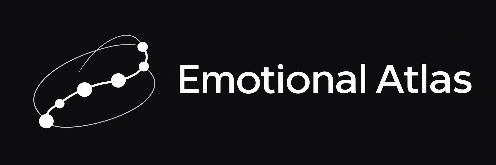

<p align="center"></p>

<div align="left">

**Technical paper:** [PDF](docs/acm/Emotional-Atlas.pdf) · [Markdown](docs/TECHNICAL_REPORT.md) · [LaTeX](docs/acm/main.tex) · [Complete LaTeX package](docs/acm/Emotional-Atlas-ACM-source.zip) · [Markdown](docs/acm/TECHNICAL_PAPER.md) · [Figures and source](docs/acm/)

</div>

# Emotional Atlas 1.0

**Explore, visualize, and transform emotional movement in dreams and literature.**

Emotional Atlas is a native desktop application that uses **OpenAI GPT-6 Luna or a VT ARC model** to infer emotional meaning, identify supporting words and passages, and map paragraphs or sentences in an interactive 3D space. Version 1.0 includes text-order animation, PCA, solid and evolving 3D/4D objects, multilingual idiom candidates, and emotional shape transfer with resumable checkpoints. The monochrome interface offers Dark and Light modes, with color retained for plot data and selected object surfaces.

[Download macOS v1.0](https://github.com/FL2744/Emotional-Atlas/releases/tag/v1.0) · [Technical report](docs/TECHNICAL_REPORT.md) · [User guide](docs/USER_GUIDE.md) · [Release notes](CHANGELOG.md)

Version 1.0 promotes the current feature set to the 1.0 release; it retains compatibility with existing analysis sessions and transfer checkpoints. The technical report documents the same implementation feature set under version 0.9.10.

## Features

- Open UTF-8 `.txt` files or paste text; split by blank lines or individual lines, with optional sentence-level analysis.
- Choose Dark or Light beside Method; plot colors remain unchanged.
- Explore solid/evolving objects, multilingual idiom candidates, and emotional shape transfer with resumable checkpoints.
- Infer intensity, valence, and inward/outward direction with OpenAI `gpt-6-luna` or a VT ARC model.
- Inspect emotional components, experiencers, targets, exact evidence, and highlighted signal words.
- Rotate, zoom, and click paragraphs in the 3D plot; open a synchronized expanded plot at up to twice the display area.
- Animate existing results in text order with pause, restart, scrubbing, and adjustable speed. **Playback requires no API key or new inference.**
- Switch to standardized **2D or 3D PCA** of the three emotional scores; inspect component weights and explained variance.
- Save and reopen JSON sessions, resume unfinished analysis, and export paragraph scores or PCA data.
- Keep verified results when an individual paragraph fails evidence validation; unresolved paragraphs are marked **Needs review**.

## Install on macOS

The v1.0 binary targets **Apple Silicon (arm64), macOS 15 or later**. The bundled binaries are checked for a macOS 15.0 or earlier deployment target; the packaged app is smoke-tested on macOS 26.6.2. Intel and other operating systems do not have packaged releases yet.

1. Download `Emotional-Atlas-v1.0-macOS-arm64.zip` from the [v1.0 release](https://github.com/FL2744/Emotional-Atlas/releases/tag/v1.0).
2. Extract the ZIP and drag **Emotional Atlas.app** into Applications.
3. Open the app.

Python and Tk are bundled; no separate Python installation is needed for this download. The release is **Developer ID signed and Apple-notarized**, with the notarization ticket stapled to the app. A SHA-256 checksum accompanies the download. macOS may show its normal first-launch confirmation for an app downloaded from the Internet.

## First analysis

1. Choose **Open .txt**, or paste a passage.
2. Choose **OpenAI** or **VT ARC** under **API provider**, then enter your personal key. OpenAI uses `gpt-6-luna` and bills your API project. VT ARC defaults to `gpt-oss-120b`; choose or enter another ARC model ID if needed. Create your personal ARC key at [llm.arc.vt.edu](https://llm.arc.vt.edu/) under **Settings → Account → API keys**. See [ARC’s API documentation](https://docs.arc.vt.edu/ai/011_llm_api_arc_vt_edu.html).
3. For a small trial, select **First 12 remaining** and click **Analyze / Resume**.
4. Click a plotted point to inspect the text and why it received its scores.
5. Click **Save session** to preserve the source and results. Reopen that JSON file with **Open session** later.

To view an existing analysis, open its session and press **Play**. You do not need to enter a key or click Analyze. A CSV export is not a resumable session.

## Understanding the plots

| Emotional axis | Range | Meaning |
| --- | --- | --- |
| Valence | −1 to +1 | Unpleasant to pleasant emotional tone |
| Direction | −1 to +1 | Internal/self-focused to directed toward others or the world |
| Intensity | 0 to 1 | Absent to extreme strength of feeling |

Each point is one paragraph. Color also represents original valence. Unknown direction is not treated as zero: the paragraph remains in the table and is omitted from the plot. Mixed feelings are retained as separate emotional components even when net valence is near zero.

**PCA is calculated from these three standardized scores, not text embeddings.** PC1 and PC2 provide a two-dimensional projection; keeping all three components preserves all variance in the three inputs. PCA needs at least three eligible paragraphs and some score variation. See [PCA details](docs/USER_GUIDE.md#pca-views) for exclusions, weighting, and interpretation.

These are model-generated interpretations, not validated psychological measurements or diagnoses. Evidence checking verifies that cited text exists; it does not establish that an interpretation is correct.

## Privacy and reliability

- Your key stays in process memory and is excluded from saved sessions and exports.
- Analysis sends target paragraphs and nearby context directly to the selected provider. OpenAI uses the Responses API with `store=false`. VT ARC uses its Chat Completions API; ARC logs interactions under VT policies. Provider data policies apply.
- Provider keys are separate and stay in memory. Sessions record the provider and model, never keys. Legacy OpenAI sessions remain compatible. Changing model or provider for existing results requires starting a new analysis, so scores from different models are not mixed.
- ARC uses JSON mode with the same local score, schema, and evidence validation and source-word repair as OpenAI. The selected ARC model must support JSON mode. No alternate model is silently substituted.
- No analytics, cloud storage, or automatic local session saving is implemented.
- Saved sessions include the full source text and analysis. Keep them private if the text is sensitive. The repository excludes session files, exports, environment files, and build outputs by default.
- Long documents are processed incrementally. Nearby context is included, but the model does not maintain whole-book memory.
- Missing or invalid evidence is retried using source-word selection. Unverified results are not assigned fabricated fallback scores.
- Network or account errors pause the run. Stop waits for the in-flight request, up to its 150-second timeout. Interrupted and repair requests may incur API usage.

## Run from source

Requires **Python 3.10+ with Tk**. The interface uses Tk; solid geometry requires NumPy and SciPy. Install the pinned runtime dependencies below.

```bash
git clone https://github.com/FL2744/Emotional-Atlas.git
cd Emotional-Atlas
python3 -m pip install -r requirements.txt
python3 app.py
```

On macOS, you can also double-click `Start.command`. Linux distributions may require their `python3-tk` package. Source operation outside macOS is not verified in this release.

## Tests and macOS build

```bash
python3 -m unittest discover -p 'test_*.py' -v

# Build on an Apple Silicon Mac with Python + Tk installed.
python3 -m venv .venv
source .venv/bin/activate
python -m pip install -r requirements-build.txt
PYTHON="$PWD/.venv/bin/python" bash scripts/build_macos.sh
```

For a signed, notarized release, use your installed Developer ID certificate and an existing Keychain notarization profile (never store Apple credentials in the repository):

```bash
DEVELOPER_ID_APPLICATION="Developer ID Application: Your Name (TEAMID)" \
NOTARY_PROFILE="your-notary-profile" \
PYTHON="$PWD/.venv/bin/python" bash scripts/release_notarized.sh
```

The build creates `dist/Emotional Atlas.app` and a ZIP in `release/`. It uses PyInstaller and does not require an API key. The app provides an explicit offline release check:

```bash
'dist/Emotional Atlas.app/Contents/MacOS/Emotional Atlas' --smoke-test /tmp/emotion-atlas-smoke.json
```

The smoke test opens and closes its own test window and checks the icon, controls, plot expansion, PCA, and playback using synthetic data. It sends no requests. Unit tests use simulated API responses; live model quality is not proven by these tests. An optional NumPy reference test runs when NumPy is available.

## Project layout

- `app.py` — native Tk interface and interactive plot
- `analysis.py` — model prompt, schema, requests, evidence validation, and sessions
- `pca.py` — dependency-free PCA calculation
- `playback.py` — text-order playback state
- `smoke.py` — offline native release test
- `EmotionAtlas.spec` and `scripts/build_macos.sh` — macOS packaging
- `frankenstein.txt` — optional public-domain sample with its Gutenberg license

## License and credits

Application source and artwork: [MIT](LICENSE). Third-party runtimes and the optional Gutenberg text retain their own terms; see [third-party notices](THIRD_PARTY_NOTICES.md). The application icon was generated with OpenAI's image-generation tool.

### Idioms and dream imagery

**Scan idioms / Resume** runs a separate multilingual pass through the selected API.
It looks for direct uses, transformations and tentative dream-imagery echoes;
matching paragraph points become yellow. Select a paragraph for the original
idiom, language, meaning, source quote, explanation and alternative reading.
Saved sessions retain these annotations. English and Arabic have small starter
collections; Chinese has 30,895 dictionary records. Import dictionaries to extend
coverage. See [idiom documentation](docs/idioms.md) for data licenses, coverage,
request costs, interpretation limits and the import format.

### Solid and evolving objects

Open **Solid / 4D object** for a separate solid visualization: convex outer shell,
spatial-neighbor envelope, or a tube following paragraph order. Explore cumulative
growth or moving-window evolution with paragraph order as the fourth dimension.
Export OBJ meshes, mathematical descriptions, and complete geometry/evolution JSON.
See [object documentation](docs/objects.md) for definitions, coordinates and limitations.

### Optional sentence-level analysis

Enable **Sentence-level analysis (granular)** beneath Paragraph breaks to score
each sentence independently. It is off by default. Each sentence becomes one
plot point and one playback/evolution step; neighboring sentences provide context
only. Changing granularity starts a separate analysis. Saved sessions retain the
mode and source text; old sessions default to paragraph mode. Sentence CSV exports
use a `sentence` ID column; object metadata records `text_unit: sentence`.

Segmentation is local and punctuation-based, supporting `. ! ? ؟ 。 ！ ？`, closing
quotes, common English abbreviations and decimals. Ambiguous abbreviations, dialogue
attributions, unusual punctuation and punctuation-free text may need manual edits.
The displayed unit count helps check segmentation before sending API requests.
Granular analysis generally produces more units and can increase API usage.
Legacy JSON field names such as `paragraphs` and `paragraph` remain stable;
`segmentation` / `text_unit` identify whether those IDs represent sentences.

### Emotional shape transfer

Analyze a source, then open **Emotional shape transfer…** to revise a separate target
toward its emotional trajectory. Supports paragraph/sentence alignment, transfer
strength, flexible transformation (default) or strict meaning preservation, bounded attempts, geometry comparisons, and TXT/JSON
exports. Source geometry is used directly from memory; no export is required.
Flexible transformation is the default and permits meaning changes; Preserve meaning offers stricter editing. Neither guarantees an exact shape match.
See [transfer documentation](docs/shape-transfer.md) for workflow, limits and math.
