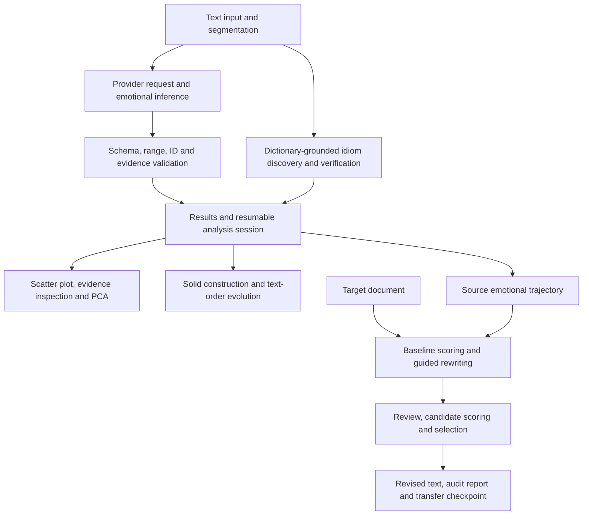
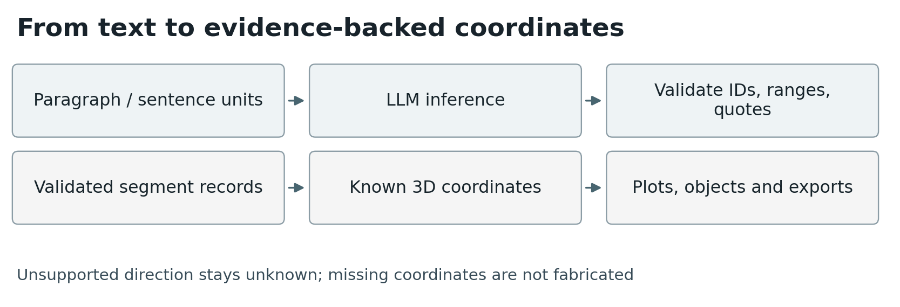
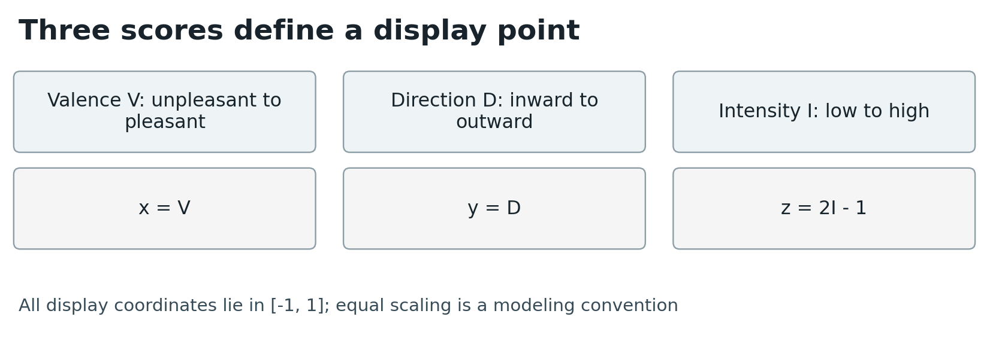
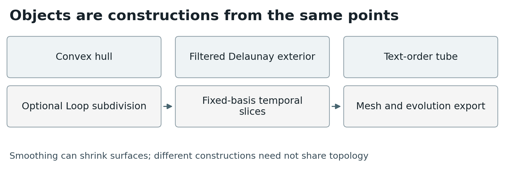
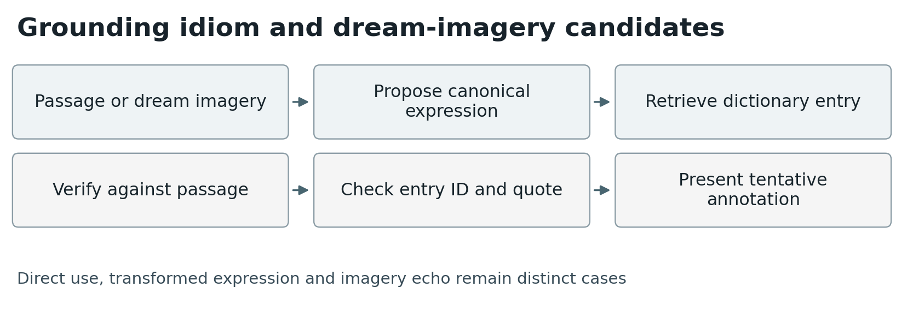
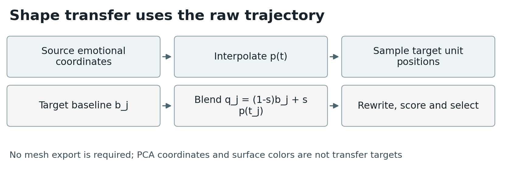

# Emotional Atlas: Emotional Geometry, Textual Evolution, and Shape-Guided Revision

**ACM manuscript:** [PDF](Emotional-Atlas.pdf) · [LaTeX source](main.tex) · [Complete LaTeX package](Emotional-Atlas-ACM-source.zip)

**William Taggart**  
Modern and Classical Languages and Literatures  
Virginia Tech  
Email: [wtaggart@vt.edu](mailto:wtaggart@vt.edu)

**Technical report · November 11, 2026 · Software version 0.9.10**

## Abstract

Emotional Atlas is a desktop environment for examining emotional movement in literary texts and dream reports. It combines large language model (LLM) inference with locally validated textual evidence, a three-coordinate emotional representation, interactive visualization, geometric construction, and text-order evolution. A separate multilingual idiom workflow proposes direct expressions, transformed expressions, and tentative imagery echoes. An emotional shape-transfer workspace uses the trajectory of a source analysis to guide revision of another text. The system supports conservative editing and a more permissive transformation policy, reports its decisions, and preserves resumable checkpoints. This report describes the implemented algorithms, data flow, operational constraints, and verification of version 0.9.10. The scores and interpretations are model judgments, not established psychometric measurements; software verification does not establish interpretive accuracy or transfer efficacy.

## 1. Scope and design

The application supports exploratory reading and computational experimentation. Its central unit is a text segment: ordinarily a paragraph, optionally a line, or a sentence when granular analysis is enabled. The interface preserves a distinction between source text, inferred emotional descriptions, derived coordinates, and geometric representations. Changing a surface or viewing mode does not change the underlying scores.

The main window contains text input, provider controls, the primary scatter plot, results, and evidence inspection. Expanded plots, solid/evolving objects, and shape transfer use separate windows. Dark mode is the startup default; a Light option changes interface backgrounds and text across open and newly created windows. Valence colors, yellow idiom markers, and user-selected surface colors remain distinct from interface appearance.

This report describes implemented functionality. It does not claim that emotional meaning has a unique geometric form, that a dream image has a determinate symbolic meaning, or that generated revisions preserve facts in flexible mode.

## 2. Architecture and execution

The application is written in Python with Tk/ttk. Network inference runs in worker threads, with queued events delivered to the GUI. Geometry and export operations also use background work where implemented. Local plotting, playback, PCA, and saved-result inspection do not require new model requests.

| Component | Responsibility |
| --- | --- |
| `app.py` | Main interface, canvas plotting, source/session controls and orchestration |
| `analysis.py` | Provider adapters, inference prompt, validation, evidence repair and session serialization |
| `segmentation.py` | Local sentence-boundary heuristics |
| `pca.py`, `playback.py` | Standardized PCA and text-order playback |
| `idioms.py`, `datasets/` | Idiom retrieval, verification and dictionary provenance |
| `geometry.py`, `object_view.py` | Solid construction, subdivision, rendering and object export |
| `evolution_export.py` | Bounded, cancellable evolution export |
| `shape_transfer.py`, `transfer_view.py` | Trajectory alignment, rewriting, selection and transfer interface |
| `transfer_session.py`, `session_identity.py` | Transfer checkpoints and distinct timestamped session identities |
| `appearance.py` | Light/dark interface palette |
| `smoke.py`, `test_*.py` | Offline native checks and automated regression tests |

The configured OpenAI adapter uses the Responses API and model identifier `gpt-6-luna`. VT ARC uses a Chat Completions-compatible endpoint, defaults to `gpt-oss-120b`, and permits a user-specified model identifier. These are software configuration values, not guarantees of provider availability. The application does not silently substitute another model. Transfer uses the source analysis's provider/model to reduce one source of scoring inconsistency.

*Illustration 1. Analysis pipeline. Model judgments are locally validated against source evidence before eligible segments enter geometry; validation is not evidence of psychometric accuracy.*

## 3. Emotional inference and evidence

### 3.1 Representation

For segment i, the model returns intensity I_i in [0,1], valence V_i in [-1,1], and direction D_i in [-1,1] or an unknown value. Intensity denotes strength of feeling rather than physical activity or arousal. Valence runs from unpleasant to pleasant. Direction runs from inward/self-focused to directed toward another person, object, or the world.

The response also contains tone, an ordinal uncertainty judgment, a summary, and up to five emotional experiences. Each experience identifies an experiencer, target where supported, emotional scores, explanations, and evidence. Opposing feelings can remain separate even when net valence is near zero. Low/medium/high uncertainty is not a calibrated probability.

The prompt asks the model to distinguish expressed emotion from negated, hypothetical, quoted, or merely mentioned emotion and to consider metaphor, irony, and speaker changes. These are instructions to the model, not demonstrated guarantees.

### 3.2 Validation and recovery

Local validation checks response structure, IDs, numeric ranges, directional consistency, and evidence correspondence. Evidence must resolve to source wording; limited normalization accommodates formatting differences without introducing fuzzy semantic matching. Signal words must be supported by the quoted evidence. Nearby context is supplied for interpretation but is not a valid substitute for evidence in the target segment.

Ordinary analysis batches contain up to six units under an 18,000-character target-text budget. An individual oversized unit can exceed that batching budget, subject to the analysis unit limit. Neighboring context is bounded to 1,200 characters on each side. The system therefore does not maintain complete book-length context.

Valid results are retained when a neighboring segment fails. Failed evidence may be repaired through source-word selection. Passage-specific response or repair failures are marked for review and processing continues. Provider, account, transport, or certificate failures stop the run rather than being misclassified as textual failures. Stop is cooperative; an active network request can take up to its 150-second timeout to return. No fallback emotional scores are fabricated.

### 3.3 Segmentation

Sentence analysis is opt-in. The local heuristic recognizes common English, Arabic, and Chinese terminal punctuation, selected abbreviations, decimal patterns, and closing punctuation. It is not a trained multilingual sentence parser. Dialogue, unusual abbreviations, poetry, and punctuation-free text can be segmented imperfectly. Changing analysis granularity starts a separate analysis; saved metadata identifies the segmentation mode even where legacy fields retain names such as `paragraphs`.

*Illustration 2. Emotional coordinate mapping. Intensity is centered for display, while an unknown direction prevents construction of a complete point. PCA, when used, acts on these scores rather than token embeddings.*

## 4. Emotional geometry and PCA

The primary plot embeds a segment as:

$$p_i=(V_i,D_i,2I_i-1)\in[-1,1]^3.$$

This puts all three display axes on the same numeric range. The equal scaling is a modeling convention, not an empirically established equality of emotional distances. Color represents valence unless an idiom annotation activates a yellow marker.

Unknown direction is not replaced with zero. Such segments remain available in the results but lack a full 3D coordinate and are excluded from geometry. Thus an empty original-target plot does not by itself establish emotional neutrality: it can indicate unsupported direction. Identical coordinates can also overlap.

PCA operates on the three existing scores, not on text embeddings. Each nonconstant feature is centered and divided by its sample standard deviation. A Jacobi eigendecomposition of the resulting 3-by-3 covariance matrix supplies components and explained-variance ratios. Constant features contribute zero. At least three eligible segments and nonzero variation are required. Retaining all three PCs preserves the variance of these three inputs; it does not preserve every semantic feature of the text. Component signs are conventional, and nearly equal eigenvalues can make individual axes unstable.

The evolving-object view fits PCA once to its full snapshot and retains the same basis and display scale across frames. This avoids apparent motion caused solely by refitting the coordinate system at each time step.

## 5. Solid objects, curved surfaces and evolution

Three constructions are implemented:

1. **Outermost points:** the convex hull of unique eligible points. It encloses the sample but fills gaps and concavities.
2. **Spatial neighbors:** a 3D Delaunay tetrahedralization filtered by a maximum-edge-length threshold. Exterior faces of retained tetrahedra form the surface. This is a specific thresholded tetrahedral construction, not a general claim to recover the text's intrinsic topology. It may produce disconnected components, cavities or nonmanifold contacts.
3. **Text-order tube:** polygonal rings swept along consecutive emotional positions, with caps on connected runs. Missing coordinates break the path. Thickness is user-controlled, and crossings or tight bends can self-intersect; tube volume is not claimed.

Coplanar or collinear samples do not define a full-dimensional hull. The interface explains such cases instead of inventing thickness. NumPy and SciPy provide numerical operations and hull/tetrahedral computations.

One to three Loop subdivision steps create tessellated approximations to curved surfaces from suitable closed manifold control meshes. Each step replaces a triangle with four and updates vertices through weighted neighbor averages. Smoothing generally rounds and shrinks a shape: a smoothed hull need not contain every source point. Area and eligible volume are recomputed from the resulting mesh. A single chosen surface color is shaded to convey depth; OBJ export includes a corresponding MTL file.

The fourth coordinate is normalized text order:

$$\tau_i=\frac{i-1}{N-1},$$

with zero used for a one-unit text. Cumulative evolution includes eligible points through i; moving-window evolution includes positions max(1,i-w+1) through i. Missing coordinates still occupy timeline positions. The displayed sequence is a family of 3D slices S_i, conceptually defining:

$$W=\bigcup_{i=1}^{N-1}S_i\times[\tau_i,\tau_{i+1}),$$

plus the final slice at the endpoint. This is text-order evolution, not elapsed reading time or a projected 4D convex hull. Topology can change between slices, and unmatched vertices are not interpolated.

*Illustration 3. Object-view schematic. The three surface constructions and optional smoothing do not change the underlying emotional scores. Evolution denotes text-order slices, not a four-dimensional convex hull.*

## 6. Multilingual idioms and dream imagery

Idiom scanning is a separate workflow. It distinguishes possible direct use, transformed expressions, and imagery echoes. One request proposes canonical expressions; local retrieval grounds candidates in available dictionary entries; a subsequent request verifies retrieved candidates against the passage. Known dictionary IDs and source quotes are checked locally.

The bundled inventory contains 20 English and 10 Arabic starter expressions with project-authored glosses, plus 30,895 Chinese records adapted from `pwxcoo/chinese-xinhua`, revision `fe6d6c2e8baa82187f4c96bbe042e43f96c05666`. Its MIT license and attribution are retained in the repository. Inventory size does not measure detection accuracy. English/Arabic coverage is preliminary; dialect variation and Chinese traditional/simplified normalization remain limitations. Imported dictionaries extend coverage and must supply IDs, language, phrase, meaning, source and license metadata.

An image such as someone taking a goat could be proposed as an echo of “get your goat,” but lexical overlap or an object alone is insufficient proof. Alternative readings are presented. These annotations are interpretive hypotheses, not explanations of a dreamer's mental state. ChengyuBench is identified in project documentation as a potential evaluation resource; it is not bundled or used to establish the system's accuracy.

*Illustration 4. Idiom workflow. A literal image alone is not proof of an idiom; retrieved expressions and quoted evidence support hypotheses with alternative readings.*

## 7. Emotional shape transfer

### 7.1 Alignment and objective

Transfer snapshots the source analysis directly from memory. No mesh export is required. It uses the raw emotional trajectory, not PCA coordinates, a convex hull, Loop-smoothed surface, or chosen surface color.

Known source coordinates form a piecewise-linear trajectory p(t) over normalized source-unit positions. Gaps are interpolated and positions beyond the known range clamp to the nearest endpoint. A target with M processing units samples t_j=(j-1)/(M-1); a one-unit target samples t=0.5. With baseline target point b_j and strength s:

$$q_j=(1-s)b_j+s\,p(t_j).$$

If the baseline lacks a supported direction, the complete baseline point is unavailable and q_j is set to p(t_j). Candidate distance is:

$$e_j=\frac{\lVert c_j-q_j\rVert_2}{2\sqrt{3}}.$$

This normalizes distance by the cube diagonal. It is not a calibrated measure of literary quality. Resampling trajectories does not guarantee equal hulls, volume, or topology.

### 7.2 Generation, review and selection

The workflow scores the original target, generates a revision, reviews it, scores the candidate without supplying desired coordinates to the scorer, and finally scores the assembled result in its revised neighboring context. One or two revision attempts can be selected. A second attempt receives feedback from the first. The original, requested, and revised trajectories are displayed separately.

**Flexible transformation**, the default, permits substantial changes to imagery, perspective, emotional reactions, supporting details and local events. The review asks whether the result remains coherent, readable and recognizably related to the target. Meaning and numeric changes are disclosed rather than used as automatic vetoes. Among reasonable scored revisions actually generated, the closest is selected—even if the original scored closer. This policy favors transformation but cannot promise improvement or factual fidelity.

**Preserve meaning** requires a review with no semantic concerns, unchanged numeric content under the local check, supported direction, and a lower distance than the current best. The original or a prior accepted candidate remains when no candidate qualifies. Neither policy is a global optimization procedure or a guarantee of an exact emotional match. The reviewer and scorer can share model biases; a separate API call does not constitute independent human validation.

### 7.3 Long documents, boundaries and failures

There is no fixed document-length or unit-count cap in transfer preparation. Oversized units are divided internally into passages of at most 3,000 characters, preferring sentence boundaries and then whitespace. Target request batches use up to six units and a 6,000-character text budget; surrounding context and structured metadata add to actual request size. Users load and export one document. Original separators are retained between spans; replacement text can introduce additional sentence or paragraph boundaries within a span. The entire replacement is scored under its original ID. A subsequent sentence-level reanalysis may therefore produce a different number of points.

A normal one-attempt batch uses approximately five model calls before correction, retries or failure isolation; two attempts add another rewrite/review/scoring cycle. Long documents can require substantial time and API usage. Completed-response usage counters can undercount requests whose responses were interrupted or rejected before accounting was returned.

Passage-specific failures trigger bounded batch isolation. Persistently failing passages are flagged, retaining the original or an accepted earlier revision, and later passages continue automatically. Final-scoring failures preserve the revision but leave its earlier score provisional. Report records distinguish these failures from completed verification. Provider/transport failures and explicit cancellation still stop processing.

*Illustration 5. Transfer schematic. Source geometry is sampled from the in-memory analysis. Candidate selection depends on the configured policy and assessed coordinates, with resumable audit records.*

## 8. Persistence and exports

| Artifact | Purpose and contents |
| --- | --- |
| Analysis session (`emotion-atlas-v1`) | Source text, segmentation, provider/model, results, reviews, idioms, usage, stable session ID/name and creation/save timestamps |
| Score CSV / PCA JSON | Tabular scores or PCA coordinates and transform metadata; not full resumable analysis sessions |
| Object OBJ/MTL, TXT, JSON | Mesh/material, mathematical description, source mapping and construction parameters; static JSON format `emotional-atlas-object-v1` |
| Evolution JSON | `emotional-atlas-evolution-v2`; complete timeline and reconstruction data, optionally sampled meshes |
| Revised TXT / transfer audit JSON | Selected text; or `emotional-atlas-transfer-v1` with attempts, reviews, errors, scores, policy and usage |
| Transfer checkpoint | `emotional-atlas-transfer-session-v1`; source snapshot, target/settings, completed work, errors, usage, identity and completion state for later resumption |

Transfer checkpoints can be saved during processing and reopened without an active source session. They exclude in-flight work and unfinished batches, which may need to run again. Completed rewrites and final scores are skipped on resume. Saves use a temporary file followed by atomic replacement so failed writes do not overwrite the prior checkpoint. This is manual checkpointing, not continuous autosave.

Compact evolution export avoids calculating meshes and retains complete reconstruction data. Sampled-mesh export is capped at 60 frames, 1,500 source points per sampled frame, 20,000 triangles per frame, and 250,000 triangles overall. It streams output and retains at most one calculated mesh at a time. Export pauses playback and supports cancellation; a native triangulation must finish before cancellation can take effect. Current evolution exports leave hypervolume uncomputed rather than running every slice merely to obtain that scalar.

## 9. Privacy, dependencies and distribution

API keys are held in process memory and excluded from app-generated sessions, checkpoints and exports. Text and bounded context are sent to the selected inference provider; OpenAI requests set `store=false`. This setting alone is not a statement about every provider retention policy. Local artifacts contain original text, generated drafts, evidence and potentially sensitive analysis and should be handled accordingly. No analytics or automatic cloud session storage is implemented.

The source dependencies include Python/Tk, NumPy 2.5.4 and SciPy 1.17.1. Packaging uses PyInstaller 6.22.3 with the pinned build requirements. The macOS distribution targets Apple Silicon and macOS 15 or later. Deployment-target inspection is performed on bundled native binaries; native testing was performed on the build host, not on every supported macOS version. There is no packaged Intel release in this version.

The release workflow builds the app, verifies its signature and native deployment targets, runs an offline native smoke test, checks provider connectivity without doing paid text inference, submits the archive to Apple's notarization service, staples an accepted ticket, verifies Gatekeeper assessment, and regenerates the ZIP checksum. Apple notarization addresses distribution checks, not the scientific validity of the application.

Apple accepted the v0.9.10 submission (`0e9fddd1-f38c-4df4-9913-52fab7f86239`); ticket stapling and validation succeeded, and Gatekeeper assessed the application as an accepted Notarized Developer ID app. All 106 inspected Mach-O binaries met the arm64/macOS deployment-target checks. Provider connectivity checks reached the services without credentials (HTTP 401/403); these establish connectivity, not authenticated inference access.

## 10. Verification and research limitations

For this release, **93 automated tests passed**. Offline native smoke tests exercise startup, controls, plots, idiom annotations, geometry/evolution exports, shape transfer and checkpoint reopening. Additional native checks verified saving during an active simulated transfer and switching Light/Dark appearance across existing and newly opened windows while retaining data colors. The tests use synthetic fixtures and mocked model responses; no benchmark of live-model interpretation or revision quality is claimed.

Geometric fixtures include known-volume shapes, degenerate inputs, neighborhood thresholds and moving windows. Transfer tests cover interpolation, candidate selection, strict/flexible policies, changes in sentence boundaries, long-text assembly, automatic failure continuation, checkpoint validation, atomic saves and resumption. These tests establish specified software behavior under their fixtures, not universal correctness.

A rigorous future evaluation should measure: inter-reader agreement on emotional coordinates; stability across repeated model runs and providers; native-speaker idiom precision/recall with literal-negative controls; sensitivity to segmentation and geometry parameters; transfer-distance change alongside human judgments of coherence and semantic change; and runtime/API cost across document lengths. Source and target alignment, missing direction, sparse source analyses, prompt sensitivity, model self-evaluation, and limited multilingual starter coverage are material sources of uncertainty.

Emotional Atlas should therefore be understood as an inspectable experimental instrument for reading and transformation. Its strongest technical commitments are traceable source evidence, explicit geometric definitions, visible selection policies, and exportable records—not objective measurement of a person's emotions.

## AI-use disclosure

This project was created with assistance from GPT-6 Astra and Codex. AI tools supported software development, testing, and drafting and revision of this technical report. William Taggart is responsible for the research decisions and final software and documentation. AI assistance does not constitute independent validation of the implementation or its scientific claims; the verification evidence and limitations are stated separately in this report.

## 11. Implementation references

The report corresponds to version 0.9.10 in this repository. Primary implementation and operational documentation:

- [Inference and validation](https://github.com/FL2744/Emotional-Atlas/blob/main/analysis.py), [PCA](https://github.com/FL2744/Emotional-Atlas/blob/main/pca.py), and [segmentation](https://github.com/FL2744/Emotional-Atlas/blob/main/segmentation.py).
- [Geometry implementation](https://github.com/FL2744/Emotional-Atlas/blob/main/geometry.py) and [solid/evolving-object guide](https://github.com/FL2744/Emotional-Atlas/blob/main/docs/objects.md).
- [Idiom implementation](https://github.com/FL2744/Emotional-Atlas/blob/main/idioms.py), [idiom data and limitations](https://github.com/FL2744/Emotional-Atlas/blob/main/docs/idioms.md), and [third-party notices](https://github.com/FL2744/Emotional-Atlas/blob/main/THIRD_PARTY_NOTICES.md).
- [Shape-transfer engine](https://github.com/FL2744/Emotional-Atlas/blob/main/shape_transfer.py), [transfer guide](https://github.com/FL2744/Emotional-Atlas/blob/main/docs/shape-transfer.md), and [checkpoint implementation](https://github.com/FL2744/Emotional-Atlas/blob/main/transfer_session.py).
- [Native smoke checks](https://github.com/FL2744/Emotional-Atlas/blob/main/smoke.py), [release workflow](https://github.com/FL2744/Emotional-Atlas/blob/main/scripts/release_notarized.sh), and [release history](https://github.com/FL2744/Emotional-Atlas/blob/main/CHANGELOG.md).

## Suggested citation

William Taggart. 2026. Emotional Atlas: Emotional Geometry, Textual Evolution, and Shape-Guided Revision. Technical report on software version 0.9.10. Modern and Classical Languages and Literatures, Virginia Tech. ACM manuscript edition, November 13, 2026. https://github.com/FL2744/Emotional-Atlas
